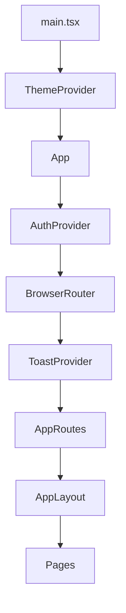
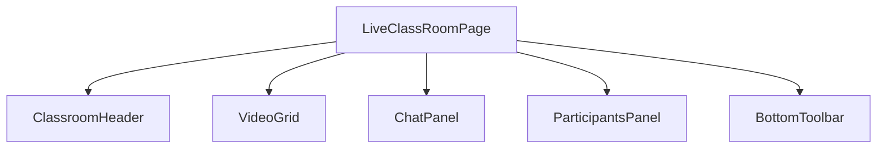

# Component Hierarchy

## Root
`main.tsx` -> ThemeProvider -> App -> AuthProvider -> BrowserRouter -> ToastProvider -> AppRoutes.

## Layouts
- `AppLayout` (src/components/AppLayout.tsx) wraps protected pages: Navbar, Breadcrumbs, DashboardSidebar/Topbar maybe.
- `AuthLayout` (src/components/AuthLayout.tsx) for login/register.
- Classroom components in src/components/classroom/.

## Shared Components
src/components: Alert, EmptyState, LoadingScreen, Skeleton, StatCard, CourseCard, EnrollButton, FormField, PasswordField, BrandLogo, AuthArtwork, Breadcrumbs, Navbar, Toast, ThemeToggle, AccessCheckPanel, OlympiadPromoBanner.
UI primitives: src/components/ui/* (button, card, dialog, badge, spinner, tabs, tooltip, dropdown, participant-avatar).

## Pages
27 pages in src/pages (see route map). Lazy loaded.

## Mermaid

